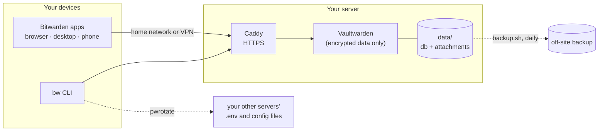

# Your own password manager, open source, in one evening

[](https://github.com/thejocorp/self-hosted-password-manager/actions/workflows/ci.yml)


[](LICENSE)

A step-by-step guide and a ready set of files to run **Vaultwarden** (an open-source server that
speaks the Bitwarden protocol) and use the **official Bitwarden apps** with it on every device:
browser extensions, desktop, iPhone, Android and the command line. Your passwords live on your
own machine, encrypted end to end, and you pay nothing.

It is the setup this account runs at home, written down: private by default, real HTTPS, no
open sign-ups, two-step login, tested backups, and at the end two things most guides skip:
**rotating your servers' secrets from the vault**, and **keeping AI-agent plugins away from it**.



**Contents:** [1 What you need](#1-what-you-need) · [2 Private or public](#2-private-or-public) ·
[3 Start the server](#3-start-the-server) · [4 Your account](#4-your-account) ·
[5 Connect the apps](#5-connect-the-apps) · [6 Lock it down](#6-lock-it-down) ·
[7 Backups](#7-backups) · [8 Family and teams](#8-family-and-teams) ·
[9 Your servers' secrets](#9-your-servers-secrets-rotate-them-from-the-vault) ·
[10 AI agents](#10-ai-agents-and-your-vault) · [Updates](#updating) · [Troubleshooting](#troubleshooting)

## 1. What you need

- A Linux machine that stays on: a mini PC, a Raspberry Pi 4/5, a NAS with Docker, or a small
  cloud server. Vaultwarden needs about 50 MB of RAM.
- Docker with the compose plugin.
- A domain name you control, for example `vault.example.com`, pointing at that machine. The
  Bitwarden apps insist on HTTPS with a real certificate; a name is how you get one for free.

## 2. Private or public

Decide this first; it is the biggest security choice in the whole setup.

| | **Private** (recommended) | **Public** |
|---|---|---|
| reachable from | your home network and your VPN only | anywhere |
| on the road | phone and laptop use the VPN (WireGuard, Tailscale, NetBird...) | just works |
| attack surface | nobody on the internet can even try a password | the login page is on the internet |
| file | `caddy/Caddyfile.private` | `caddy/Caddyfile.public` |

The apps keep an offline copy of your vault, so with the private setup you can still read and
fill passwords when the VPN is off; you just cannot sync until you are back.

Both setups get a real Let's Encrypt certificate. For the private one, ports 80 and 443 still
have to reach Caddy so it can prove the name is yours; everything else from the internet gets a
403. If you would rather keep the ports closed, use Caddy's DNS challenge instead.

## 3. Start the server

```sh
git clone https://github.com/thejocorp/self-hosted-password-manager vault && cd vault
cp .env.example .env                                  # DOMAIN=vault.example.com
cp vaultwarden.env.example vaultwarden.env && chmod 600 vaultwarden.env   # DOMAIN=https://vault.example.com
cp caddy/Caddyfile.private caddy/Caddyfile            # or Caddyfile.public
docker compose up -d
docker compose logs -f caddy                          # wait for "certificate obtained successfully"
```

Then, from a machine on your network: `scripts/check.sh https://vault.example.com`. It only
reads and tells you what is fine and what to look at.

## 4. Your account

Sign-ups are off from the start, so nobody else can grab the server before you do. To create
your own account, open it once:

```sh
sed -i 's/^SIGNUPS_ALLOWED=false/SIGNUPS_ALLOWED=true/' vaultwarden.env && docker compose up -d
```

Open `https://vault.example.com`, **Create account**, and choose a master password you can
remember but nobody can guess: four or five random words is a good shape. It cannot be
recovered. Vaultwarden only ever sees your vault encrypted with it. Then close the door again:

```sh
sed -i 's/^SIGNUPS_ALLOWED=true/SIGNUPS_ALLOWED=false/' vaultwarden.env && docker compose up -d
```

Now, in the web vault: **Settings → Security → Two-step login**, and turn on an authenticator
app or a passkey/security key. Save the recovery code somewhere that is not this vault.

## 5. Connect the apps

Every official Bitwarden app can talk to your server. On the login screen choose
**Logging in on: self-hosted** (in older versions the gear icon), enter
`https://vault.example.com`, then log in as usual.

| app | where |
|---|---|
| browser extension | Chrome, Firefox, Safari, Edge, Brave: from their extension stores |
| desktop | Windows, macOS, Linux: bitwarden.com/download |
| phone | App Store / Google Play: "Bitwarden Password Manager" |
| command line | `npm install -g @bitwarden/cli`, then `bw config server https://vault.example.com` |

Importing from another password manager: web vault → **Tools → Import data**; Bitwarden reads
exports from 1Password, LastPass, Chrome, Firefox, KeePass and many more.

## 6. Lock it down

Already done by the files in this repository:

- [x] sign-ups closed, invitations only (`SIGNUPS_ALLOWED=false`, `INVITATIONS_ALLOWED=true`)
- [x] password hints off
- [x] built-in brakes on repeated wrong logins (`LOGIN_RATELIMIT_*`)
- [x] HTTPS with HSTS, Vaultwarden's own port not exposed, the container cannot gain privileges
- [x] admin page off (no `ADMIN_TOKEN`); in the public setup it is never served from outside
- [x] the Vaultwarden version pinned, so nothing changes under you

Up to you:

- [ ] two-step login on **every** account, not just yours
- [ ] `ORG_CREATION_USERS=your@email` once your account exists
- [ ] mail settings (SMTP) so invitations and new-device alerts work
- [ ] when you need the admin page: make a hash (`docker compose run --rm vaultwarden /vaultwarden hash`),
      put it in `vaultwarden.env` in single quotes, use the page, remove it again
- [ ] backups, next section

## 7. Backups

`scripts/backup.sh` copies the database with SQLite's online backup (safe while Vaultwarden is
running), checks the copy, adds attachments, Sends, settings and keys, and writes one private
archive. Old archives are removed after `KEEP_DAYS` (30).

```sh
scripts/backup.sh ./data /srv/backups/vault
# encrypted, for copying off-site:
AGE_RECIPIENT=age1... scripts/backup.sh ./data /srv/backups/vault
```

Run it daily (a cron line: `15 3 * * * cd /path/to/vault && scripts/backup.sh ./data /srv/backups/vault`)
and copy the archives to a second place: another disk, another house, a cloud bucket.
**Test a restore once**, it takes two minutes:

```sh
docker compose down
mv data data.old && mkdir data && tar -xzf /srv/backups/vault/vaultwarden-<date>.tar.gz -C data
docker compose up -d                                   # log in, check a few items, then rm -r data.old
```

A second, independent copy costs nothing: in any Bitwarden app **Export vault** as an
*encrypted* JSON file now and then. That one opens in bitwarden.com or any other Vaultwarden too.

## 8. Family and teams

Create an **organization** (web vault → New organization) and invite people by email (needs
the mail settings) or let them sign up while you briefly open sign-ups. Inside it,
**collections** decide who sees what: "Family", "Streaming", "Servers". Each person still has a
private vault of their own.

**Emergency access** (Settings → Emergency access) lets someone you trust request access to
your vault after a waiting period you choose. Worth setting up for a partner.

## 9. Your servers' secrets: rotate them from the vault

Once your vault is the place where passwords live, it can be the place where your servers'
secrets live too: database passwords, API keys, tokens in `.env` files. The usual problem is that
each one is copied into several files on several machines, so nobody ever changes them.

[**pw-manager-auto-rotate**](https://github.com/thejocorp/pw-manager-auto-rotate) (`pwrotate`)
fixes that with the vault you just built. You list where each secret lives; it keeps every copy
in step with the Bitwarden item, rotates on request, restarts and checks your services, and
**rolls everything back if a check fails**. The item's notes list every place the secret is
used, so the vault doubles as the map.

```sh
pipx install git+https://github.com/thejocorp/pw-manager-auto-rotate
bw config server https://vault.example.com && bw login && export BW_SESSION=$(bw unlock --raw)
pwrotate --manifest secrets.yaml doctor
pwrotate --manifest secrets.yaml rotate myapp/api-key
```

How to set it up in the vault:

1. Make an organization collection **Servers** and keep server secrets there, not in your
   personal vault.
2. For automation (a nightly drift check), make a separate account that can only see that one
   collection and log it in with an API key. If that machine is ever compromised, your personal
   passwords are not in reach.
3. Put `bitwarden: {organization: ..., collection: Servers}` at the top of the manifest.

## 10. AI agents and your vault

Coding agents (Claude Code, Codex, Cursor and friends) install plugins, skills and MCP servers
that run with **your** user's rights. One that is malicious or careless can read a `BW_SESSION`
from your shell environment, the `bw` CLI's data folder, or the `.env` files this guide just
taught you to keep in step.

- Do not `export BW_SESSION` in a terminal where an agent runs; unlock in a separate shell.
- Use the narrow automation account from section 9 for scripts, never your own.
- Check a plugin before you install it. [**plugin-vet**](https://github.com/thejocorp/plugin-vet)
  is a static scanner for agent plugins, skills and MCP servers: committed secrets, prompt
  injection, pipe-to-shell installs, hidden binaries, telemetry, hooks that run on every call.

```sh
pipx install git+https://github.com/thejocorp/plugin-vet
plugin-vet ./some-plugin
```

## Updating

Watch Vaultwarden's [releases](https://github.com/dani-garcia/vaultwarden/releases) (on GitHub:
Watch → Custom → Releases). To update: take a backup, change the tag in `compose.yaml`,
`docker compose pull && docker compose up -d`, run `scripts/check.sh`.

## Troubleshooting

| symptom | usually |
|---|---|
| app says the certificate is not trusted | the certificate was not issued yet: `docker compose logs caddy`; ports 80/443 must reach Caddy |
| "403 Private." on the phone | you are outside your network and the VPN is off (private setup working as intended) |
| new items do not appear on other devices | live sync uses WebSockets through Caddy; check no other proxy in front strips them |
| locked out of the admin page | it is off by design; see section 6 to turn it on for a moment |
| forgot the master password | it cannot be recovered, by design; that is what emergency access is for |

## The kit

| | |
|---|---|
| **self-hosted-password-manager** | this guide: your own Vaultwarden with the Bitwarden apps |
| [pw-manager-auto-rotate](https://github.com/thejocorp/pw-manager-auto-rotate) | rotate your servers' secrets from it |
| [plugin-vet](https://github.com/thejocorp/plugin-vet) | check AI-agent plugins before they get near it |

## License

MIT. Vaultwarden is a separate open-source project (AGPL-3.0) by its own authors; the Bitwarden
apps are by Bitwarden, Inc. This guide is not affiliated with either.
